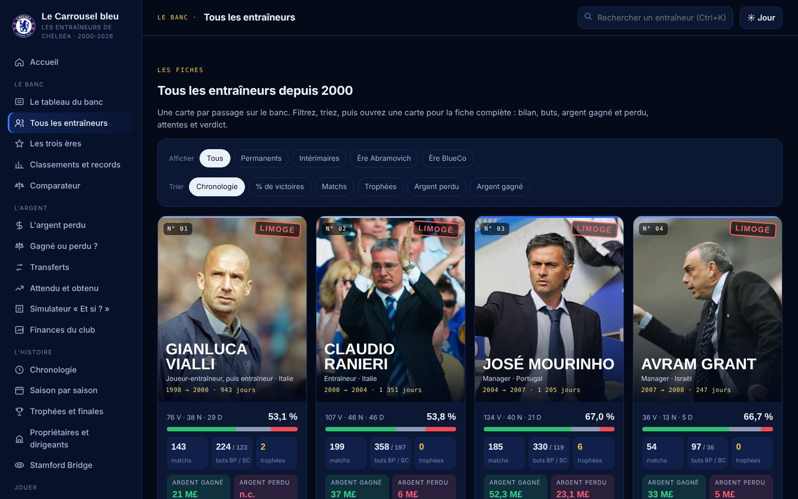
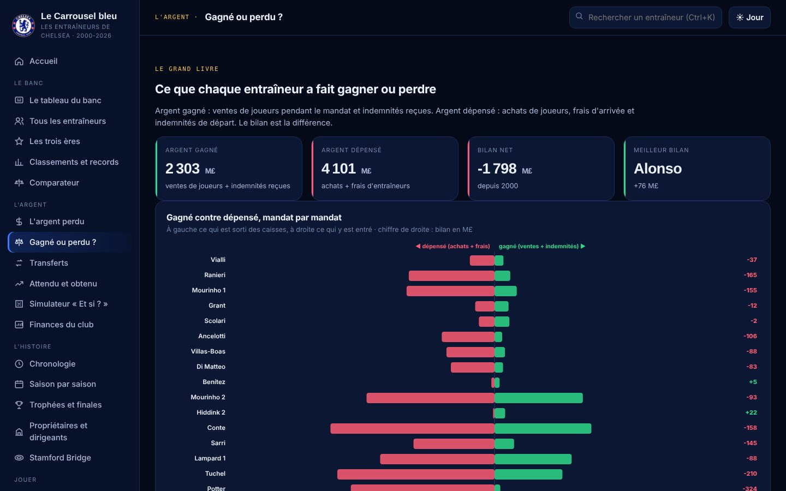
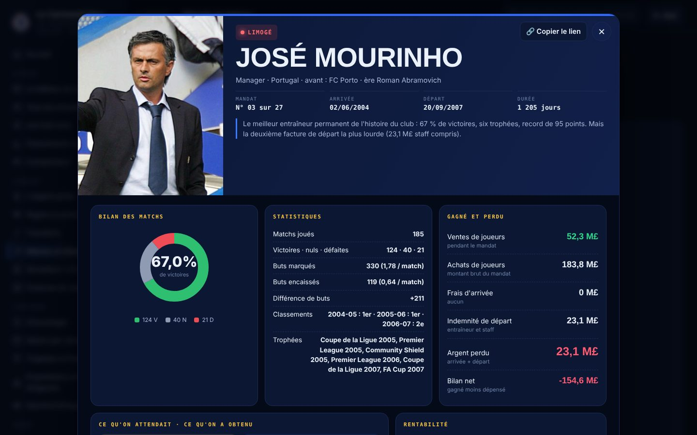
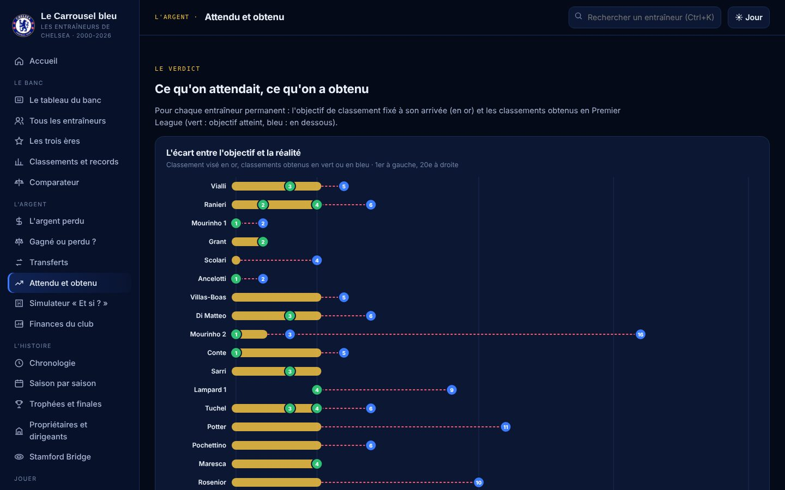
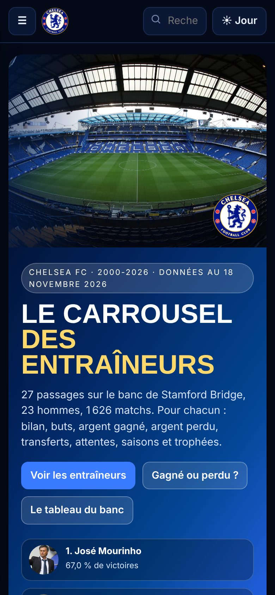

# ⚽ Chelsea FC · Le carrousel des entraîneurs (2000-2026)

Application interactive sur les 27 passages sur le banc de Chelsea depuis l'an 2000 : bilans, buts, argent gagné, argent perdu, transferts, attentes, saisons, trophées, propriétaires et finances du club.

👉 **Ouvrir l'application :** https://abdoulhamiddiallo.github.io/chelsea-entraineurs/

---

## 📸 Aperçu

| Tous les entraîneurs | Gagné ou perdu ? |
|---|---|
|  |  |

| Fiche d'un entraîneur | Attendu et obtenu |
|---|---|
|  |  |

---

## 📊 Les chiffres clés

| Indicateur | Valeur |
|---|---|
| Passages sur le banc depuis 2000 | **27** (23 hommes) |
| Matchs dirigés | **1 626** |
| Trophées | **25**, dont 5 titres de champion et 2 Ligues des champions |
| Argent perdu en arrivées et départs d'entraîneurs | **212,1 M£** |
| Départ le plus cher | **Antonio Conte, 26,6 M£** (2018) |
| Arrivée la plus chère | **Graham Potter, 21,5 M£** versés à Brighton (2022) |
| Meilleur pourcentage de victoires (entraîneur permanent) | **José Mourinho, 67,0 %** |

---

## 🧭 Ce que contient l'application

- **Le mur des 27** : tous les entraîneurs dans l'ordre d'arrivée, avec numéro, années, pourcentage de victoires et trophées.
- **La machine à remonter le temps** : un curseur de 2000 à aujourd'hui, qui montre l'entraîneur en poste, l'argent déjà perdu et les trophées gagnés à chaque date.
- **Une fiche par entraîneur** : bilan des matchs, buts, argent gagné et perdu, bilan net, objectif et résultat, profil de jeu, principales recrues.
- **Les trois ères** : Ken Bates, Roman Abramovich et BlueCo comparés.
- **L'argent** : argent perdu, grand livre gagné contre dépensé, transferts, prix d'une victoire, simulateur « Et si ? », finances du club de 2004 à 2025.
- **L'histoire** : chronologie, saison par saison, trophées et finales, propriétaires et dirigeants, Stamford Bridge.
- **Comparateur** de deux entraîneurs, **classements** triables, **recherche** (Ctrl+K) et **quiz**.
- **Thème jour et nuit**, version **téléphone** soignée.

---

## 🗂️ Sources

Bilans des entraîneurs (Wikipédia, arrêtés au 8 novembre 2026), indemnités (Daily Mail, The Telegraph, The Athletic, Sports Illustrated, BBC, Reuters, Sky Sports, City AM), transferts (Transfer League, Capology, Al Jazeera), comptes annuels de Chelsea FC (communiqués du club relayés par la presse, SalarySport, Forbes). Le détail figure dans la page « Sources et méthode » de l'application.

---

## 🛠️ Technique

Un seul fichier `index.html` autonome : HTML, CSS et JavaScript, graphiques SVG dessinés à la main, photos intégrées. Aucune dépendance, publié avec GitHub Pages.

---

## 👤 Auteur

**Abdoul Hamid Diallo** · Microsoft Fabric Data Engineer
[LinkedIn](https://www.linkedin.com/in/abdoul-hamid-diallo-fabric-data-engineer/) · [Toutes mes applications](https://abdoulhamiddiallo.github.io/)
